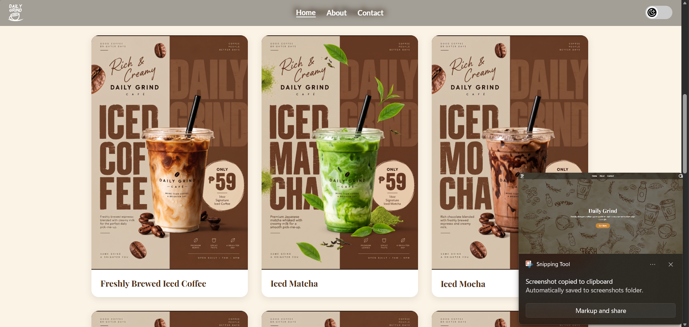
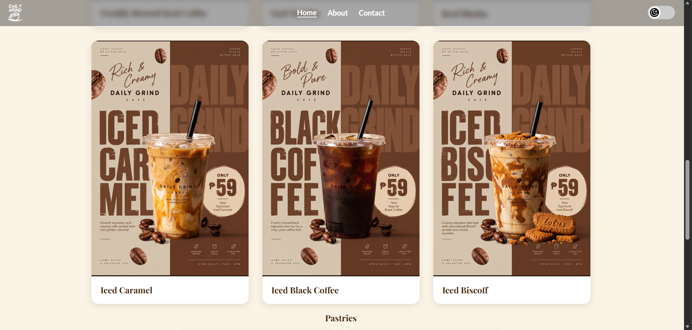
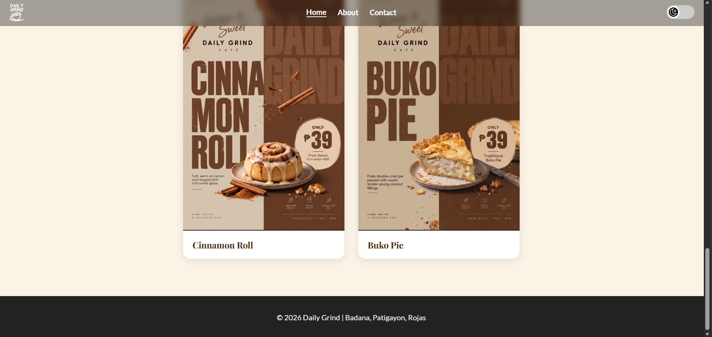
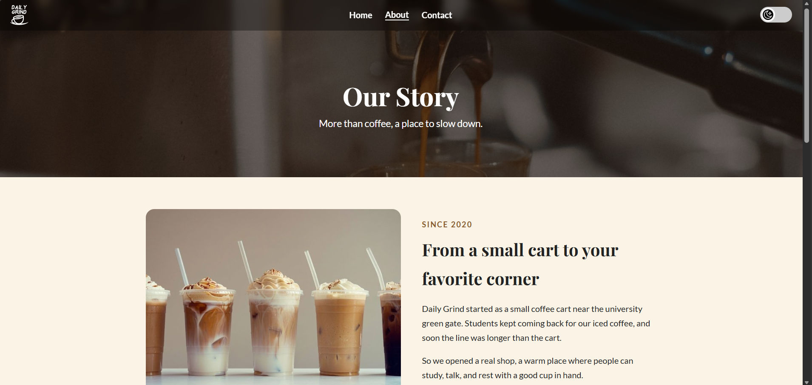
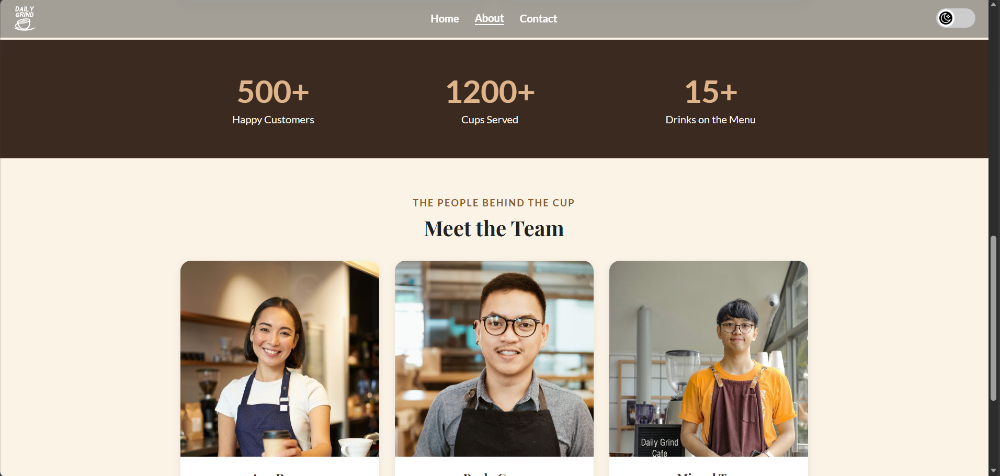
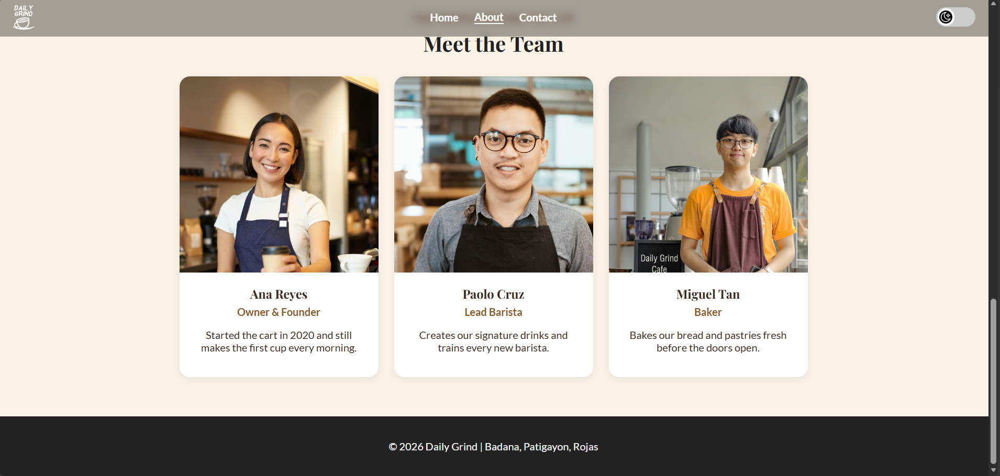
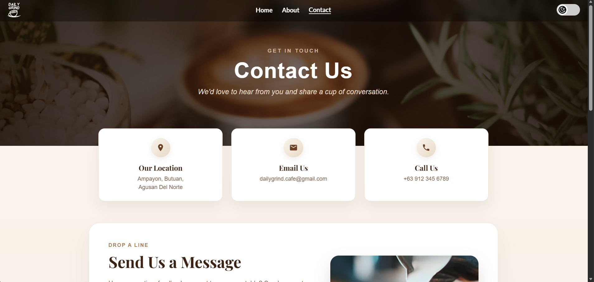
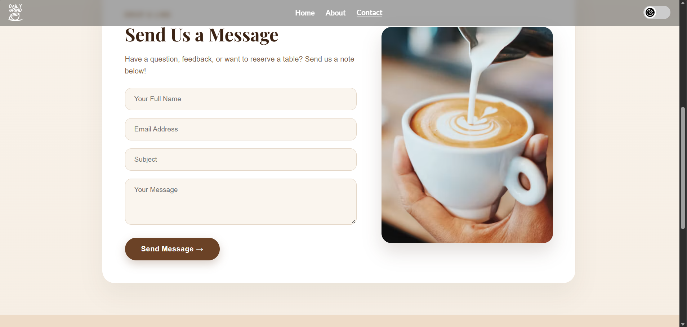
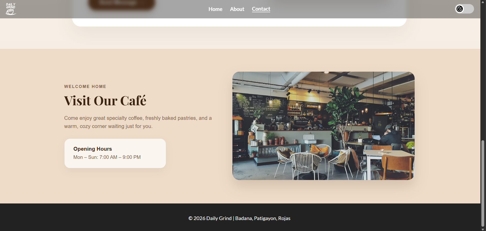

# Lara-Proj-AIBJ2-Badana-Patigayon-Rojas

# Daily Grind Café — Multi-Page Laravel Web Application

Group Information
- Section: AIBJ2
- Theme: Local Café Website — Daily Grind Café
- Group Members:
  - Member 1 (Group Leader): Vince B. Badana
  - Member 2: Johanne P. Patigayon
  - Member 3: Rica Mae Rojas

Module Assignments and Git Branches

Member 1: Vince B. Badana
- Assigned Module: Project Setup, Master Layout, and Home Page
- Branch Name: `dev-member1-Badana`
- Features and JavaScript Functionality: Master Blade layout (`layouts/app.blade.php`), responsive navigation bar and footer, Hero section, Café intro, Featured Products grid (beverages and local pastries), Dark/Light mode toggle

Member 2: Johanne P. Patigayon
- Assigned Module: About Page
- Branch Name: `dev-member2-Patigayon`
- Features and JavaScript Functionality: Café background story, Mission and Vision, Team/Staff cards, [Read More / Read Less toggle OR Animated number counters]

Member 3: Rica Mae Rojas
- Assigned Module: Contact Page
- Branch Name: `dev-member3-Rojas`
- Features and JavaScript Functionality: Contact form (name, email, subject, message) and café contact details, Client-side form validation with error and success messages

Page Screenshots

Home Page







About Page







Contact Page







Steps to Run the Project Locally

1. Clone the repository
   ```bash
   git clone https://github.com/<your-github-username>/Lara-Proj-AIBJ2-Badana-Patigayon-Rojas.git
   cd Lara-Proj-AIBJ2-Badana-Patigayon-Rojas